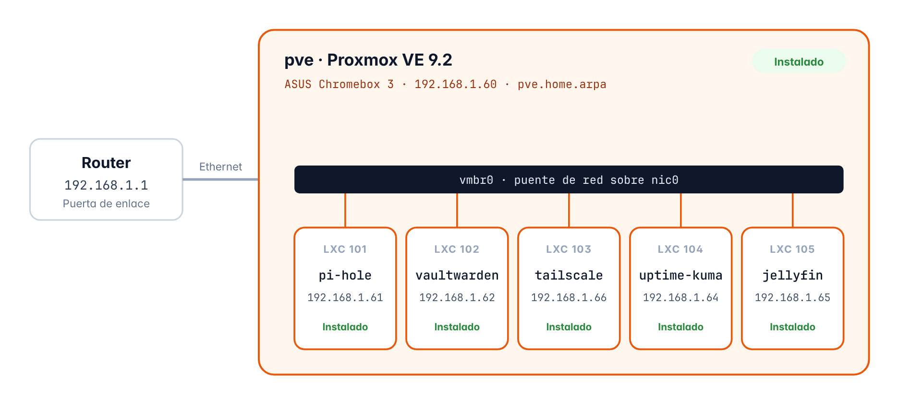

# Homelab casero

Este es mi servidor casero, lo he montado con Proxmox VE 9.2 en un ASUS Chromebox 3 que tenía por casa y la idea es tener varios servicios funcionando a la vez, cada uno en su propio contenedor LXC con Debian 13, así si uno falla o lo tengo que reinstalar los demás siguen funcionando sin problema

Ahora mismo tengo Pi-hole con Unbound para bloquear anuncios en toda la red de casa, Vaultwarden como gestor de contraseñas, Tailscale para poder entrar desde fuera, Uptime Kuma para vigilar que todo funcione y Jellyfin para ver películas, y todo lo he ido instalando a mano y apuntando paso a paso, es decir que en la carpeta `docs` está explicado qué hice, con qué valores y por qué lo hice así



## Servicios

Estos son los servicios que tengo ahora mismo, cada uno en su contenedor

| CT | Servicio | IP | Para qué lo uso | Recursos |
| --- | --- | --- | --- | --- |
| — | Proxmox VE 9.2 | `192.168.1.60` | Es donde funcionan todos los contenedores | Celeron 3865U · 16 GB RAM · SSD 480 GB |
| 101 | Pi-hole + Unbound | `192.168.1.61` | Bloquea anuncios, rastreadores y malware en toda la red y hace de DNS propio con DNSSEC | 1 núcleo · 1 GiB · 8 GiB |
| 102 | Vaultwarden (Docker) | `192.168.1.62` | Mi gestor de contraseñas, funciona con las apps de Bitwarden y tiene HTTPS gracias a Tailscale | 1 núcleo · 1 GiB · 8 GiB |
| 103 | Tailscale | `192.168.1.66` | Para entrar a toda la red de casa desde fuera sin abrir puertos (subnet router) | 1 núcleo · 512 MiB · 8 GiB |
| 104 | Uptime Kuma | `192.168.1.64` | Vigila los servicios y me manda un correo si alguno se cae | 1 núcleo · 1 GiB · 8 GiB |
| 105 | Jellyfin | `192.168.1.65` | Para ver películas y series, y convierte el vídeo con la gráfica (Intel Quick Sync) | 2 núcleos · 2 GiB · 16 GiB + 100 GiB |

## Por qué lo he montado así

Lo primero es que he usado contenedores LXC en vez de máquinas virtuales ya que el procesador solo tiene 2 núcleos y una máquina virtual gasta bastante más, entonces con contenedores me da para tenerlo todo encendido a la vez sin que vaya lento

Además he puesto un servicio en cada contenedor porque así puedo reiniciar o actualizar uno sin tocar el resto, y Docker solo lo uso en Vaultwarden porque es la forma oficial de instalarlo, los demás van directamente sobre Debian

Para entrar desde fuera de casa he usado Tailscale en vez de abrir puertos en el router, ya que así no expongo nada a internet y encima me da HTTPS para Vaultwarden sin tener que pelearme con certificados

Y por último en Pi-hole he puesto Unbound como DNS propio, o sea que ya no depende de Cloudflare ni de nadie, y en Jellyfin la conversión de vídeo la hace la gráfica Intel del Chromebox y no el procesador, que si no se quedaría corto

## Lo que mejor me ha salido

Lo que más me gustó fue mejorar Pi-hole, porque lo medí con [Blockmeter](https://blockmeter.io) antes y después y pasé de un **49 %** a un **90 %**, con los anuncios, los rastreadores y el malware bloqueados al 100 % y sin que se rompa ninguna web ni app de las que uso cada día, y lo tengo todo explicado en el [apartado 6.16](docs/06-pihole.md#616-resultado-final)

## Documentación

Toda la documentación la tengo también en un PDF ([Homelab-casero_Documentacion_v1.6.pdf](docs/Homelab-casero_Documentacion_v1.6.pdf)), y aquí está cada capítulo por separado

| | Capítulo | Qué hay |
| --- | --- | --- |
| **Parte I** | **Servidor base** | |
| 1 | [Visión general](docs/01-vision-general.md) | El equipo, por qué lo monté así y cómo repartí las IPs |
| 2 | [Preparación](docs/02-preparacion.md) | La copia de lo que tenía antes, la ISO y el pendrive |
| 3 | [Instalación de Proxmox VE](docs/03-instalacion-proxmox.md) | Lo que puse en cada pantalla del instalador |
| 4 | [Configuración posterior](docs/04-configuracion-proxmox.md) | Los repositorios gratis y la actualización del sistema |
| 5 | [Verificación](docs/05-verificacion.md) | Las comprobaciones y la ficha final del servidor |
| **Parte II** | **Servicios** | |
| 6 | [Pi-hole](docs/06-pihole.md) | La instalación y las mejoras, con las listas HaGeZi, Unbound, DNSSEC y Pi-hole fuera de casa |
| 7 | [Vaultwarden](docs/07-vaultwarden.md) | Docker, HTTPS con Tailscale y cómo recuperé mis contraseñas |
| 8 | [Tailscale](docs/08-tailscale.md) | El subnet router para entrar a la red de casa desde fuera |
| 9 | [Uptime Kuma](docs/09-uptime-kuma.md) | Seis monitores y los avisos por correo |
| 10 | [Jellyfin](docs/10-jellyfin.md) | La conversión de vídeo con la gráfica y cómo subo las películas por SFTP |
| **Anexo** | [Glosario](docs/anexo-a-glosario.md) | Las palabras técnicas explicadas de forma sencilla |

## Cómo está organizado

En la carpeta `docs` está la documentación y en `configs` están los archivos de configuración que uso de verdad

```text
homelab/
├── README.md
├── CHANGELOG.md                 Las versiones de la documentación
├── docs/
│   ├── 01-vision-general.md     Un archivo por capítulo
│   ├── ...
│   ├── anexo-a-glosario.md
│   ├── img/                     Las figuras
│   └── Homelab-casero_Documentacion_v1.6.pdf
└── configs/
    ├── pihole/
    │   ├── listas-de-bloqueo.txt
    │   └── unbound-pi-hole.conf
    ├── vaultwarden/
    │   └── compose.yaml
    └── uptime-kuma/
        └── uptime-kuma.service
```

## Lo que me falta

Me falta un disco USB externo para hacer copias de seguridad automáticas de los contenedores y para sacar las películas del SSD

## Sobre los datos

Aquí no hay ninguna contraseña, correo ni clave, y el nombre de la tailnet, las IPs de Tailscale, los nombres de mis dispositivos, una dirección MAC y una huella SSH los he cambiado por valores de ejemplo, y las IPs `192.168.1.x` son de la red de mi casa, así que desde internet no se puede llegar a ellas

---

Alejandro Pérez · 2º de ASIR · Institut Esteve Terradas i Illa
