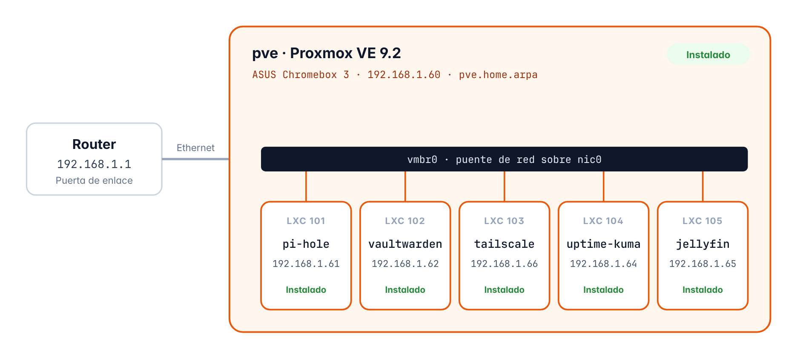

# Capítulo 1 · Visión general del homelab

*Qué es este homelab, con qué equipo funciona, por qué lo he montado así y cómo he repartido las IPs*

[Índice](../README.md#documentación) · [Preparación de la instalación →](02-preparacion.md)

## 1.1 Objetivo

Mi homelab es un servidor que tengo en casa con **Proxmox VE** instalado en un **ASUS Chromebox 3**, y la idea es que cada servicio vaya en su **propio contenedor LXC** con su propia IP, así todo queda separado y si un servicio falla o lo tengo que reinstalar los demás siguen funcionando sin problema

Los servicios que tengo ahora mismo son estos

- **Pi-hole**, que bloquea anuncios y rastreadores en toda la red de casa usando el DNS
- **Vaultwarden**, mi propio gestor de contraseñas, que funciona con las apps de Bitwarden
- **Tailscale**, para entrar a la red de casa desde fuera sin abrir puertos en el router
- **Uptime Kuma**, que vigila que todos los servicios estén funcionando
- **Jellyfin**, para ver películas y series, y que convierte el vídeo usando la gráfica

## 1.2 Hardware del servidor

| Elemento | Detalle |
| --- | --- |
| Equipo | ASUS Chromebox 3 |
| Procesador | Intel Celeron 3865U · 2 núcleos / 2 hilos · 1,8 GHz |
| Memoria RAM | 16 GB |
| Almacenamiento | SSD de 480 GB (447,1 GiB) |
| Gráfica integrada | Intel HD Graphics 610, que tiene Quick Sync para el vídeo |
| Red | Por cable Ethernet (la interfaz `nic0`) |
| Firmware | Le quité el firmware original de ChromeOS y le puse uno UEFI para poder instalar cualquier sistema |
| Funcionamiento | Encendido todo el día, 24/7 |

## 1.3 Por qué lo monté así

### Contenedores LXC y no máquinas virtuales

El procesador solo tiene 2 núcleos, así que es lo que más se queda corto en este equipo, y una **máquina virtual** es como un ordenador entero simulado con su propio sistema y su propio kernel, o sea que cada una gasta bastantes recursos, en cambio un **contenedor LXC** usa el mismo kernel que Proxmox, arranca en unos segundos y gasta muy poca RAM, y aun así cada contenedor tiene su propia IP, su propio Debian y sus propios programas

### Un servicio en cada contenedor

Cada servicio va en su contenedor y así puedo reiniciar, actualizar, hacer copias o reinstalar uno sin tocar el resto, y además de un vistazo ya sé qué hay en cada IP

### Docker solo donde hace falta

Vaultwarden oficialmente solo viene como imagen de Docker, así que en su contenedor sí que he puesto Docker, pero los demás servicios los he instalado directamente en su contenedor y sin Docker

### Entrar desde fuera con Tailscale

Para entrar al homelab cuando no estoy en casa uso Tailscale, que es una VPN que funciona con WireGuard y no hace falta abrir ningún puerto en el router, y encima le da a Vaultwarden una dirección con HTTPS sin que yo me tenga que preocupar de los certificados

### Todo a mano

Todo lo he instalado a mano y paso a paso, sin scripts que lo hagan todo solos, porque así entiendo lo que hace cada cosa y además me queda apuntado

### Lo que dejo para más adelante

Los otros equipos que tengo (el Minisforum Z83-F y el ASUS Chromebox CN60) de momento están guardados y no forman parte del homelab, y TrueNAS lo dejo para más adelante porque el Chromebox 3 solo tiene sitio para un disco por dentro

## 1.4 Plan de red e IPs

| Elemento | Detalle |
| --- | --- |
| Red local | `192.168.1.0/24` |
| Router / puerta de enlace | `192.168.1.1` · Movistar Router Smart WiFi 6 Go |
| Reservas DHCP | El router solo me deja reservar IPs a partir de la `192.168.1.33` |
| DNS de la red | `192.168.1.61` (Pi-hole), que lo reparte el router por DHCP, y los dispositivos que tienen Tailscale también lo usan estén donde estén (apartado 6.15) |

| ID | Nombre | Tipo | IP | Servicio | Estado |
| --- | --- | --- | --- | --- | --- |
| — | `pve` | Nodo | `192.168.1.60` | Proxmox VE | Instalado |
| `101` | `pi-hole` | LXC | `192.168.1.61` | Pi-hole | Instalado |
| `102` | `vaultwarden` | LXC | `192.168.1.62` | Vaultwarden | Instalado |
| `103` | `tailscale` | LXC | `192.168.1.66` | Tailscale | Instalado |
| `104` | `uptime-kuma` | LXC | `192.168.1.64` | Uptime Kuma | Instalado |
| `105` | `jellyfin` | LXC | `192.168.1.65` | Jellyfin | Instalado |

> [!NOTE]
> **Cómo pongo los nombres**
>
> El último número del ID de cada contenedor es el mismo que el último número de su IP (101 → .61, 102 → .62…), así sé qué contenedor es cuál sin tener que mirarlo, y la única excepción es el 103 (`tailscale`), que usa la `192.168.1.66`

*Figura 1 · Esquema de red del homelab, todos los contenedores se conectan a la red de casa por el puente `vmbr0`*

---

[Índice](../README.md#documentación) · [Preparación de la instalación →](02-preparacion.md)
