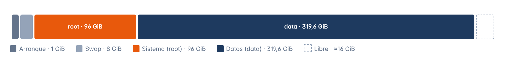

# Capítulo 3 · Instalación de Proxmox VE

*La instalación desde cero en el SSD de 480 GB del Chromebox 3, con los valores exactos que puse en cada pantalla del instalador*

[← Preparación de la instalación](02-preparacion.md) · [Índice](../README.md#documentación) · [Configuración posterior →](04-configuracion-proxmox.md)

## 3.1 Antes de empezar

Al Chromebox 3 le conecto estas cosas

- El **cable de red** directo al router, porque Proxmox necesita ir por cable ya que el WiFi no sirve como puente de red para los contenedores
- Un teclado y un monitor
- El pendrive con la instalación

## 3.2 Arranque desde el USB

1. Enciendo el equipo y le doy a **Esc** varias veces para que salga el menú de arranque
2. En el menú elijo el pendrive
3. En el menú de Proxmox elijo **Install Proxmox VE (Graphical)**

## 3.3 Asistente de instalación

El instalador tiene seis pantallas y en todas me salieron justo las opciones que esperaba

1. **Licencia (EULA)**, la acepto con **I agree**
2. **Target Harddisk**, elijo el SSD de 480 GB y en **Options** pongo el sistema de archivos **ext4**, y las opciones avanzadas del disco las dejo **por defecto** (lo explico en el apartado 3.5)
3. **Location and Time Zone**, aquí van el país, la zona horaria y el teclado
4. **Administration Password and Email**, la contraseña de `root` y el correo para los avisos del sistema
5. **Management Network Configuration**, la tarjeta de red, el nombre del equipo, la IP, la puerta de enlace y el DNS
6. **Summary**, reviso el resumen, dejo marcada la casilla para que se reinicie solo y le doy a **Install**, y cuando se reinicia quito el pendrive

### Valores que puse

| Pantalla | Campo | Valor |
| --- | --- | --- |
| **Target Harddisk** | Disco | SSD de 480 GB |
|  | Filesystem | `ext4` |
|  | Opciones avanzadas | Por defecto |
| **Location and Time Zone** | Country | Spain |
|  | Time zone | `Europe/Madrid` |
|  | Keyboard Layout | Spanish |
| **Password and Email** | Contraseña de root | *Puesta, pero no la apunto aquí* |
|  | Email | *Puesto, pero no lo apunto aquí* |
| **Network Configuration** | Management Interface | `nic0` |
|  | Hostname (FQDN) | `pve.home.arpa` |
|  | IP Address (CIDR) | `192.168.1.60/24` |
|  | Gateway | `192.168.1.1` |
|  | DNS Server | `1.1.1.1` |

## 3.4 Por qué estos valores

> [!NOTE]
> **ext4 y no ZFS**
>
> ZFS está bien cuando tienes varios discos (por ejemplo para tener copias en espejo), pero gasta bastante más RAM y CPU, y con un solo disco no me aporta casi nada, así que ext4 es lo más ligero y lo más sencillo

> [!NOTE]
> **El dominio home.arpa**
>
> `home.arpa` es el dominio que está reservado de forma oficial para las redes de casa, y es mejor que inventarse uno como `.local`, ya que ese se usa para otra cosa y puede dar problemas con los nombres

> [!NOTE]
> **DNS 1.1.1.1 y no Pi-hole**
>
> Pi-hole va a ser un contenedor dentro de este mismo Proxmox, entonces si Proxmox usara Pi-hole como DNS, al arrancar se quedaría sin DNS hasta que el contenedor estuviera encendido, por eso el servidor usa un DNS de fuera (`1.1.1.1`, que es el de Cloudflare)

> [!NOTE]
> **La tarjeta de red se llama nic0**
>
> Las versiones nuevas de Proxmox le ponen un nombre fijo a la tarjeta de red (`nic0`) para que no cambie después de actualizar el kernel, y encima de ella el instalador crea el puente `vmbr0`, que es el que tiene la IP del servidor y al que luego se conectan los contenedores

## 3.5 Distribución del disco

Con las opciones avanzadas por defecto el instalador divide el SSD en tres particiones, y la tercera la convierte en un grupo LVM que se llama `pve`, que a su vez se reparte en volúmenes para la swap, el sistema y los datos

### Particiones

| Partición | Tamaño | Para qué es | Montaje |
| --- | --- | --- | --- |
| 1 | `1007 KiB` | Arranque BIOS (por compatibilidad) | — |
| 2 | `1 GiB` | Partición EFI (para arrancar en UEFI) | `/boot/efi` |
| 3 | `446,1 GiB` | LVM, grupo `pve` | — |

### Volúmenes del grupo pve

| Volumen | Tamaño | Para qué es | En Proxmox |
| --- | --- | --- | --- |
| `swap` | `8 GiB` | Memoria de reserva | — |
| `root` | `96 GiB` | El sistema, las plantillas, las ISOs y las copias locales, montado en `/` | `local` |
| `data` | `319,6 GiB` | Almacén *thin* para los discos de los contenedores y las VMs (más 3,3 GiB de metadatos) | `local-lvm` |

### Qué hace cada opción avanzada

| Opción | Qué controla | Valor por defecto | Resultado |
| --- | --- | --- | --- |
| `hdsize` | Cuánto disco usa Proxmox | Todo el disco | `446,1 GiB` |
| `swapsize` | El tamaño de la swap | Lo mismo que la RAM, pero como mínimo 4 GB y como máximo 8 GB | `8 GiB` |
| `maxroot` | El tamaño máximo del sistema | Como mucho la cuarta parte del disco | `96 GiB` |
| `minfree` | El espacio que deja libre en el grupo | 16 GB si el disco tiene más de 128 GB | `≈16 GiB` |
| `maxvz` | El tamaño máximo del almacén de datos | Todo lo que sobra | `319,6 GiB` |

> [!NOTE]
> **¿Por qué 447 y no 480?**
>
> Los fabricantes cuentan en GB (1 GB son 1000³ bytes) y Linux cuenta en GiB (1 GiB son 1024³ bytes), así que 480 GB son 447,1 GiB, o sea que es el mismo disco pero contado de otra forma

> [!NOTE]
> **¿Qué quiere decir «thin»?**
>
> En el almacén `local-lvm` un disco de 8 GiB de un contenedor no ocupa los 8 GiB de golpe, sino solo lo que tiene escrito de verdad, y así se aprovecha mucho mejor el espacio

---

[← Preparación de la instalación](02-preparacion.md) · [Índice](../README.md#documentación) · [Configuración posterior →](04-configuracion-proxmox.md)
