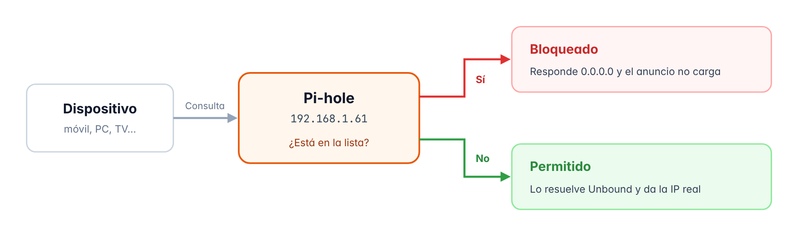
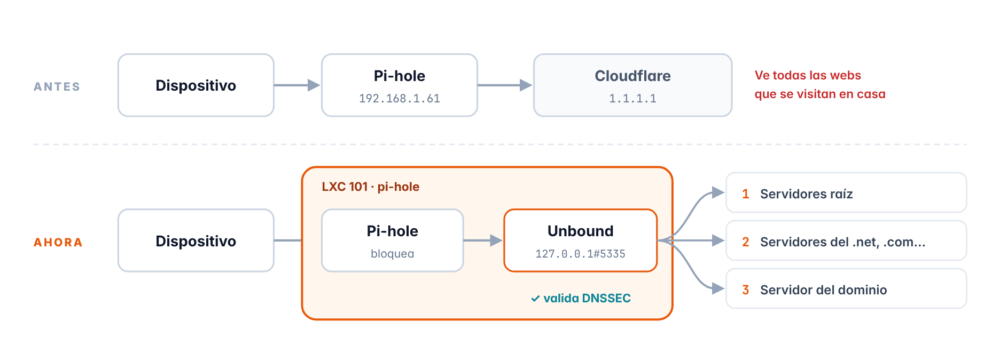

# Capítulo 6 · Pi-hole

*Bloqueo de anuncios, rastreadores y malware para toda la red de casa, metido en su propio contenedor LXC y mejorado después para que bloquee todo lo posible*

[← Verificación y estado final](05-verificacion.md) · [Índice](../README.md#documentación) · [Vaultwarden →](07-vaultwarden.md)

## 6.1 Qué es y cómo funciona

Cada vez que un dispositivo abre una web o una app, primero le pregunta a un servidor **DNS** qué IP tiene cada dominio que necesita, y eso incluye también los de anuncios y rastreadores, entonces lo que hace Pi-hole es ponerse en medio para que todos los dispositivos de casa le pregunten a él

Si el dominio está en una **lista de bloqueo**, Pi-hole contesta `0.0.0.0`, que es una dirección que no lleva a ningún sitio, y el anuncio no llega a cargar, y si no está en la lista lo resuelve **Unbound**, que es un DNS que tengo en el mismo contenedor (apartado 6.13), y devuelve la respuesta normal



*Figura 2 · Cómo decide Pi-hole si bloquea una consulta DNS o no*

> [!NOTE]
> **Lo que no puede hacer**
>
> Pi-hole bloquea por el nombre del dominio, así que no puede quitar los anuncios que vienen del mismo servidor que el contenido, como los de YouTube o los del plan con anuncios de Netflix, y tampoco quita los avisos de cookies porque son parte de la propia web

## 6.2 Ficha del contenedor

| Elemento | Detalle |
| --- | --- |
| ID | `101` |
| Nombre de host | `pi-hole` |
| Tipo | Contenedor LXC sin privilegios y con anidamiento |
| Sistema | Debian 13 (plantilla `debian-13-standard_13.1-2_amd64.tar.zst`) |
| Recursos | 1 núcleo · 1024 MiB de RAM (al crearlo eran 512 MiB, luego lo amplié en el apartado 6.11) · 512 MiB de swap · disco de 8 GiB en `local-lvm` |
| Red | `eth0` en `vmbr0` · `192.168.1.61/24` · puerta de enlace `192.168.1.1` |
| Arranque | Se enciende solo al arrancar el servidor, y es el primero (orden 1) |
| Zona horaria | La misma que el servidor (`Europe/Madrid`) |
| Software | Pi-hole (Core v6.4.3 · Web v6.6 · FTL v6.7.1) · Unbound |
| Listas de bloqueo | StevenBlack · HaGeZi Pro++ · HaGeZi TIF · HaGeZi DoH |
| Resolución DNS | Unbound en el mismo contenedor (`127.0.0.1#5335`), comprobando DNSSEC |
| Clientes | Toda la red de casa (por el DHCP del router) y los dispositivos que tienen Tailscale |
| Panel web | `http://192.168.1.61/admin` |

## 6.3 Plantilla de Debian 13

Los contenedores se crean a partir de una **plantilla**, que es como una imagen base del sistema ya preparada, y esta misma plantilla me sirve luego para el resto de contenedores del homelab

1. En la web de Proxmox voy a **pve → local (pve) → Plantillas CT → botón Plantillas**
2. Busco `debian-13-standard`, la selecciono y le doy a **Descargar**

| Elemento | Detalle |
| --- | --- |
| Plantilla descargada | `debian-13-standard_13.1-2_amd64.tar.zst` |

## 6.4 Creación del contenedor

Con el botón **Crear CT** (arriba a la derecha) se abre el asistente, y estos son los valores que puse en cada pestaña

| Pestaña | Campo | Valor |
| --- | --- | --- |
| **General** | CT ID | `101` |
|  | Nombre de host | `pi-hole` |
|  | Contenedor sin privilegios | Sí |
|  | Anidamiento | Sí |
|  | Contraseña de root | *Puesta, pero no la apunto aquí* |
| **Plantilla** | Almacenamiento | `local` |
|  | Plantilla | `debian-13-standard_13.1-2` |
| **Discos** | Almacenamiento | `local-lvm` |
|  | Tamaño del disco | 8 GiB |
| **CPU** | Núcleos | 1 |
| **Memoria** | Memoria | 512 MiB (luego la subí a 1024 MiB) |
|  | Swap | 512 MiB |
| **Red** | Nombre / Puente | `eth0 / vmbr0` |
|  | IPv4 | Estático · `192.168.1.61/24` |
|  | Puerta de enlace (IPv4) | `192.168.1.1` |
|  | IPv6 | Estático, vacío |
| **DNS** | Dominio y servidores | Vacíos (coge lo que tiene el servidor) |
| **Confirmar** | Iniciar después de creado | Sí |

> [!NOTE]
> **Por qué «sin privilegios»**
>
> En un contenedor sin privilegios el `root` de dentro no es el `root` de verdad del servidor, así que si alguien consiguiera entrar en el contenedor no podría controlar Proxmox, y además es la opción más segura y la que viene puesta por defecto

> [!NOTE]
> **Por qué un disco de 8 GiB**
>
> Pi-hole guarda un historial de consultas que va creciendo con el tiempo, por eso le dejo margen, y como `local-lvm` es de tipo *thin* el contenedor solo ocupa en el SSD lo que usa de verdad y no los 8 GiB enteros

## 6.5 Arranque automático

Esto se pone en **101 (pi-hole) → Opciones**

| Elemento | Detalle |
| --- | --- |
| Iniciar al arrancar | Sí |
| Orden de inicio/apagado | `1` |

> [!NOTE]
> **Por qué el primero**
>
> Toda la red necesita Pi-hole para los nombres, así que cuando se enciende el servidor lo mejor es que el DNS sea lo primero que esté funcionando

## 6.6 Preparación del sistema

Desde **101 → Consola** y con el usuario `root` actualizo el sistema, instalo `curl` (que hace falta para bajar el instalador) y miro la hora

```bash
apt update && apt full-upgrade -y
apt install -y curl
date
```

### Zona horaria

El contenedor no tenía la hora de España y en las opciones del contenedor de la web no hay nada para cambiarla, así que lo hice desde la **Shell de Proxmox** para que el contenedor use la misma zona horaria que el servidor

```bash
pct set 101 --timezone host
```

| Elemento | Detalle |
| --- | --- |
| `pct` | Es la herramienta de Proxmox para manejar los contenedores desde la terminal |
| `set 101` | Cambia la configuración del contenedor 101 |
| `--timezone host` | Hace que el contenedor use la zona horaria del servidor (`Europe/Madrid`) |

> [!NOTE]
> **Ojo**
>
> Proxmox pone la zona horaria cuando arranca el contenedor, así que si `date` no la enseña al momento solo hay que reiniciarlo

## 6.7 Instalación de Pi-hole

Uso el instalador oficial, pero primero lo bajo a un archivo y luego lo ejecuto, porque así puedo mirar lo que hace antes de lanzarlo (por ejemplo con `less basic-install.sh`), y todo esto en la consola del contenedor

```bash
curl -sSL https://install.pi-hole.net -o basic-install.sh
bash basic-install.sh
```

### Lo que respondí en el instalador

| Pantalla | Respuesta | Por qué |
| --- | --- | --- |
| Bienvenida y donaciones | OK | Son solo pantallas de información |
| Static IP Needed | Continue | Es solo un aviso, la IP del contenedor ya es fija |
| Upstream DNS Provider | Cloudflare | Es el DNS de fuera al que Pi-hole manda lo que no bloquea, y más adelante lo cambié por Unbound (apartado 6.13) |
| Blocklists | Yes | Activa la lista de StevenBlack, que es una lista de bloqueo muy usada |
| Enable Logging | Yes | Guarda el registro de consultas para verlo en el panel |
| Privacy mode | 0 · Show everything | Enseña todos los datos en el panel, total es la red de mi casa |

Cuando termina, el instalador te da una contraseña aleatoria para el panel web, pero yo la cambié por una mía

```bash
pihole setpassword
```

Y el panel de administración se abre en esta dirección

```text
http://192.168.1.61/admin
```

## 6.8 Verificación

### Versión instalada

Primero miro la versión desde la consola del contenedor

```bash
pihole -v
```

```text
Core version is v6.4.3 (Latest: v6.4.3)
Web version is v6.6 (Latest: v6.6)
FTL version is v6.7.1 (Latest: v6.7.1)
```

Las tres partes de Pi-hole (el núcleo, la web y FTL, que es el que hace el DNS) están en la última versión

### Resolución y bloqueo

Después desde el PC, con PowerShell, le pregunto directamente a Pi-hole por un dominio normal y por uno de publicidad

```powershell
nslookup google.com 192.168.1.61
nslookup doubleclick.net 192.168.1.61
```

```text
Servidor:  pi.hole
Address:  192.168.1.61

Respuesta no autoritativa:
Nombre:  google.com
Addresses:  2a00:1450:4003:816::200e
          216.58.205.46
```

```text
Servidor:  pi.hole
Address:  192.168.1.61

Nombre:  doubleclick.net
Addresses:  ::
          0.0.0.0
```

| Dominio | Lo que contesta Pi-hole | Resultado |
| --- | --- | --- |
| `google.com` | Sus direcciones de verdad, en IPv6 y en IPv4 | Permitido |
| `doubleclick.net` | `::` y `0.0.0.0`, que son direcciones vacías en IPv6 y en IPv4 | Bloqueado |

## 6.9 Configuración del router

Para que todos los dispositivos de casa usen Pi-hole sin tener que configurarlos uno por uno, hago que el router reparta su IP como DNS por DHCP

| Elemento | Detalle |
| --- | --- |
| Router | Movistar Router Smart WiFi 6 Go |
| Reserva DHCP | `192.168.1.61` para la MAC del contenedor 101 (la MAC se ve en **101 → Red**), y borré la reserva vieja que era de la máquina virtual de antes |
| DNS 1 | `192.168.1.61` |
| DNS 2 | Desactivado |

Los dispositivos empiezan a usar Pi-hole cuando renuevan la conexión, en Windows se puede forzar con `ipconfig /release` y `ipconfig /renew` y en los móviles basta con quitar el WiFi y volver a ponerlo

> [!NOTE]
> **Por qué no hay un segundo DNS**
>
> Si pusiera un segundo DNS de fuera (por ejemplo `1.1.1.1`), los dispositivos lo usarían a ratos y se colarían anuncios, en cambio con solo Pi-hole el bloqueo funciona siempre

> [!WARNING]
> **Si el servidor se apaga**
>
> Como solo hay un DNS, si el Chromebox se apaga o falla los dispositivos de casa no pueden abrir webs, y para tener internet mientras lo arreglo solo hay que poner el DNS del router en automático y luego volver a poner `192.168.1.61` cuando el servidor funcione

---

## Optimización de Pi-hole

Cuando ya tenía todos los servicios del homelab funcionando, mejoré Pi-hole para que bloquee lo máximo posible sin romper las webs y apps que uso cada día, y en los apartados 6.10 a 6.16 explico cada cambio y lo que conseguí con él

## 6.10 Cómo estaba antes de mejorarlo

Para ver el antes y el después usé **Blockmeter** (`blockmeter.io`), que es una web que comprueba si tu dispositivo puede llegar a unos 380 dominios reales de anuncios, rastreadores, telemetría, estafas y malware, y la prueba la hice desde el navegador del PC sin ningún bloqueador instalado, así solo cuenta lo que bloquea Pi-hole

### Resultado con la configuración del principio

Esto es lo que salió solo con la lista de StevenBlack, que es la que pone el instalador

| Categoría | Bloqueados | Porcentaje |
| --- | --- | --- |
| Anuncios | 47 de 54 | 87 % |
| Rastreadores y analítica | 43 de 55 | 78 % |
| Telemetría y rastreadores de dispositivos | 23 de 53 | 43 % |
| Estafas y malware | 3 de 14 | 21 % |
| Otros dominios de listas | 12 de 87 | 14 % |
| Contenido y filtros de salto (no cuenta para la nota) | 1 de 117 | — |
| **Total · nota de Blockmeter** | **129 de 380** | **49 %** |

La nota solo tiene en cuenta las cinco primeras categorías, y la de contenido (VPN, redes sociales, apuestas, acortadores…) solo importa si quieres bloquear esas cosas a propósito

### Lo que pensé mejorar

| Cambio | Para qué | Apartado |
| --- | --- | --- |
| Más memoria para el contenedor | Las listas nuevas son mucho más grandes | 6.11 |
| Listas HaGeZi Pro++, TIF y DoH | Bloquear más anuncios, rastreadores, telemetría y malware, y que nadie se salte Pi-hole con DNS cifrado | 6.12 |
| Unbound | Resolver los nombres sin depender de Cloudflare y comprobar las respuestas con DNSSEC | 6.13 |
| Que nadie se salte Pi-hole | Que Firefox y el iPhone no se salten Pi-hole | 6.14 |
| Pi-hole como DNS de la tailnet | Que también bloquee fuera de casa con Tailscale | 6.15 |

> [!WARNING]
> **Lo que no quise poner**
>
> - **La lista Ultimate de HaGeZi**, que es la más agresiva, y su propio autor dice que tiene mucho riesgo de romper cosas, porque limita Facebook y Messenger y puede hacer que las webs detecten mal tu país, que salgan más CAPTCHAs o que algunas funciones no vayan
> - **La lista Bypass Full**, que bloquea las VPN y los proxys, pero también bloquearía Tailscale y me quedaría sin poder entrar desde fuera, así que solo bloqueo los servidores de DNS cifrado (la lista DoH)

## 6.11 Más memoria para el contenedor

Las listas nuevas tienen muchísimos más dominios que la de StevenBlack y Pi-hole los carga en memoria al actualizarlas, entonces con 512 MiB podía ir justo y lo subí a 1 GiB desde la Shell de Proxmox

```bash
pct set 101 --memory 1024
```

El cambio se aplica al momento y no hace falta reiniciar el contenedor

## 6.12 Listas de bloqueo HaGeZi

Usé las listas de **HaGeZi**, que es un proyecto muy conocido que tiene sus listas en cinco niveles, desde *Light* hasta *Ultimate*, y para alguien que puede desbloquear algo cuando haga falta su autor recomienda juntar **Pro++** con **TIF**, y como Pro++ ya bloquea casi todos los rastreadores de las marcas (teles, móviles, Windows…) no hace falta poner sus listas *Native* aparte

En el panel de Pi-hole, en **Lists**, las fui añadiendo una por una poniendo la dirección en **Address**, el nombre en **Comment** y dándole a **Add blocklist**

| Comentario | Dirección | Qué bloquea |
| --- | --- | --- |
| **StevenBlack** | *La que pone el instalador* | Anuncios y malware, y la dejo puesta |
| **HaGeZi Pro++** | `https://raw.githubusercontent.com/hagezi/dns-blocklists/main/adblock/pro.plus.txt` | Anuncios, rastreadores, telemetría y phishing |
| **HaGeZi TIF** | `https://raw.githubusercontent.com/hagezi/dns-blocklists/main/adblock/tif.txt` | Malware, estafas y phishing, y se actualiza muy a menudo |
| **HaGeZi DoH** | `https://raw.githubusercontent.com/hagezi/dns-blocklists/main/adblock/doh.txt` | Servidores de DNS cifrado, para que nadie se salte Pi-hole |

### Actualización de Gravity

**Gravity** es lo que usa Pi-hole para bajar todas las listas y juntarlas en su base de datos, y yo lo lancé desde **Tools → Update Gravity → Update**, aunque también se puede hacer desde la consola del contenedor

```bash
pihole -g
```

Cuando acaba, en el panel principal sale en **Domains on Lists** el total de dominios de todas las listas, y los que se repiten entre listas no cuentan doble, y además Gravity se vuelve a ejecutar solo cada semana para tener las listas al día

> [!NOTE]
> **Por qué el formato Adblock**
>
> HaGeZi tiene cada lista en varios formatos, y para Pi-hole uso el formato *Adblock* (`||dominio^`) porque cada línea bloquea el dominio y también todos sus subdominios

> [!WARNING]
> **Si algo deja de funcionar**
>
> Pro++ es más estricta que Pro y alguna vez puede bloquear el enlace de una oferta, el seguimiento de un correo de publicidad o alguna función de una app, pero se arregla en un minuto buscando en **Query Log** el dominio bloqueado (sale en rojo) y dándole a **Allow**

## 6.13 Unbound, mi propio DNS

Hasta ahora Pi-hole le pasaba a Cloudflare todas las consultas que no bloqueaba, o sea que Cloudflare veía todas las webs que se visitan en mi casa, y con **Unbound** Pi-hole las resuelve él solo, ya que pregunta directamente a los **servidores raíz** de internet, después a los del dominio de primer nivel (`.net`, `.com`…) y al final al servidor del propio dominio, y además comprueba con **DNSSEC** que nadie ha cambiado las respuestas por el camino



*Figura 3 · Antes Pi-hole le pasaba a Cloudflare lo que no bloqueaba, y ahora lo resuelve Unbound él solo preguntando directamente a los servidores de internet*

### Instalación y configuración

En la consola del contenedor instalo Unbound y creo su archivo de configuración

```bash
apt install -y unbound dnsutils
nano /etc/unbound/unbound.conf.d/pi-hole.conf
```

Y dentro del archivo pongo esto

```text
server:
    verbosity: 0
    interface: 127.0.0.1
    port: 5335
    do-ip4: yes
    do-udp: yes
    do-tcp: yes
    do-ip6: no
    prefer-ip6: no
    harden-glue: yes
    harden-dnssec-stripped: yes
    use-caps-for-id: no
    edns-buffer-size: 1232
    prefetch: yes
    num-threads: 1
    private-address: 192.168.0.0/16
    private-address: 169.254.0.0/16
    private-address: 172.16.0.0/12
    private-address: 10.0.0.0/8
    private-address: fd00::/8
    private-address: fe80::/10
```

| Elemento | Detalle |
| --- | --- |
| `interface / port` | Unbound solo escucha dentro del contenedor (`127.0.0.1`) y en el puerto `5335`, porque el 53 ya lo usa Pi-hole |
| `do-ip6: no` | La red de casa va por IPv4 |
| `harden-glue / harden-dnssec-stripped` | Rechaza las respuestas raras y las que llegan sin la firma DNSSEC que tendrían que llevar |
| `edns-buffer-size: 1232` | Es el tamaño de paquete que se recomienda para que no haya problemas al partir las respuestas grandes |
| `prefetch: yes` | Renueva los dominios que más se usan antes de que caduquen, para que sigan saliendo rápido de la caché |
| `private-address` | No deja que un dominio de internet conteste con IPs de una red privada (es una protección contra el *DNS rebinding*) |

Es la configuración de la guía oficial de Pi-hole para Unbound pero sin la opción `so-rcvbuf`, porque dentro de un contenedor solo da un aviso

```bash
systemctl restart unbound
systemctl is-active unbound-resolvconf.service
# Esto solo si el comando de antes dice "active"
systemctl disable --now unbound-resolvconf.service
```

En Debian el servicio `unbound-resolvconf` puede cambiar la configuración DNS del propio contenedor y liarla con Pi-hole, así que miro si está activo y si lo está lo desactivo

### Verificación de Unbound

Le hago tres consultas directamente a Unbound, una a un dominio normal, otra a uno que tiene la firma DNSSEC rota a propósito y otra a uno con la firma bien

```bash
dig pi-hole.net @127.0.0.1 -p 5335
dig fail01.dnssec.works @127.0.0.1 -p 5335
dig dnssec.works @127.0.0.1 -p 5335
```

```text
;; ->>HEADER<<- opcode: QUERY, status: NOERROR, id: 42928
;; flags: qr rd ra; QUERY: 1, ANSWER: 1, AUTHORITY: 0, ADDITIONAL: 1
;; ANSWER SECTION:
pi-hole.net.            3600    IN      A       162.244.93.14
;; Query time: 531 msec
```

```text
;; ->>HEADER<<- opcode: QUERY, status: SERVFAIL, id: 52628
;; flags: qr rd ra; QUERY: 1, ANSWER: 0, AUTHORITY: 0, ADDITIONAL: 1
;; Query time: 1413 msec
```

```text
;; ->>HEADER<<- opcode: QUERY, status: NOERROR, id: 33785
;; flags: qr rd ra ad; QUERY: 1, ANSWER: 1, AUTHORITY: 0, ADDITIONAL: 1
;; ANSWER SECTION:
dnssec.works.           3600    IN      A       46.23.92.212
;; Query time: 39 msec
```

| Dominio | Resultado | Qué quiere decir |
| --- | --- | --- |
| `pi-hole.net` | `NOERROR` y una IP | Unbound resuelve los nombres él solo, sin Cloudflare |
| `fail01.dnssec.works` | `SERVFAIL` | Rechaza la respuesta porque la firma DNSSEC está rota |
| `dnssec.works` | `NOERROR` con la marca `ad` | Ha comprobado que la firma DNSSEC está bien |

> [!NOTE]
> **Por qué la primera consulta tardó 531 ms**
>
> Unbound empezaba sin nada guardado y tuvo que hacer todo el camino desde los servidores raíz, pero las siguientes consultas al mismo dominio salen de su caché y tardan casi 0 ms

### Pi-hole usa Unbound

En el panel de Pi-hole, en **Settings → DNS**, hago esto

1. Quito todas las casillas de **Cloudflare**
2. En **Custom DNS servers** escribo `127.0.0.1#5335`
3. Le doy a **Save**

Y para comprobar que todo el camino (dispositivo → Pi-hole → Unbound) comprueba DNSSEC, lo pruebo desde el PC con PowerShell

```powershell
nslookup dnssec.works
nslookup fail01.dnssec.works
```

El primero devuelve su IP y el segundo falla, igual que cuando le preguntaba directamente a Unbound

## 6.14 Que nadie se salte Pi-hole

Algunos programas pueden usar su propio DNS cifrado y saltarse Pi-hole, pero Pi-hole 6 ya trae unas protecciones para evitarlo, y yo comprobé que estaban activadas en **Settings → All settings → DNS**, en el apartado `dns.specialDomains`

| Opción | Estado | Qué hace |
| --- | --- | --- |
| `mozillaCanary` | Activada | Le dice a Firefox que no use su DNS cifrado en esta red |
| `iCloudPrivateRelay` | Activada | Desactiva la Retransmisión privada de iCloud en esta red, que en Safari se saltaría Pi-hole |
| `designatedResolver` | Activada | Hace que los dispositivos no se cambien por su cuenta a un DNS cifrado |

Y a esto se le suma la lista **HaGeZi DoH** del apartado 6.12, que bloquea los servidores de DNS cifrado más conocidos

> [!NOTE]
> **Lo que no se puede evitar**
>
> Algunos aparatos, como algunos Chromecast o teles, llevan un DNS puesto por la marca y esos se pueden seguir saltando Pi-hole, y para evitarlo haría falta un router que pueda redirigir todo el tráfico DNS

## 6.15 Pi-hole también fuera de casa

Cuando estaba fuera de casa con Tailscale activado, el móvil seguía usando el DNS de la red donde estuviera (por ejemplo el de la compañía de datos) y me salían anuncios, así que ahora Tailscale le da Pi-hole como DNS a todos los dispositivos de la tailnet, y las consultas llegan a Pi-hole pasando por el subnet router (LXC 103, capítulo 8)

Esto se hace en el panel de Tailscale (`login.tailscale.com`), en la parte de **DNS**

1. En **Nameservers** le doy a **Add nameserver → Custom** y pongo la IP `192.168.1.61`
2. En esa misma ventana dejo desactivados **Restrict to domain** y **Use with exit node** y le doy a **Save**
3. Activo **Override DNS servers**
4. **MagicDNS** y **HTTPS Certificates** los dejo activados porque los necesita Vaultwarden

| Elemento | Detalle |
| --- | --- |
| Nameserver | `192.168.1.61` |
| Restrict to domain (Split DNS) | No, porque quiero que Pi-hole se use para todos los dominios y no solo para algunos |
| Use with exit node | No, porque en mi homelab no uso *exit nodes* |
| Override DNS servers | Sí, así los dispositivos pasan del DNS de la red donde estén y usan Pi-hole |
| MagicDNS · HTTPS Certificates | Sí, sin tocar nada |

### Prueba con datos móviles

Con el iPhone con datos móviles y Tailscale activado, `http://doubleclick.net` ya no carga, y en el **Query Log** de Pi-hole esa consulta sale como hecha por `192.168.1.66`, que es el subnet router, porque es por donde llegan a casa las consultas de los dispositivos que están fuera

> [!NOTE]
> **El móvil se acordaba de la dirección**
>
> La primera vez la página sí cargó porque el iPhone se acordaba de la dirección de otra vez que entré y no llegó a preguntarle a Pi-hole, pero poniendo el modo avión unos segundos o usando una pestaña privada se borra eso

> [!WARNING]
> **Si el servidor se apaga**
>
> Ahora los dispositivos con Tailscale activado también dependen de Pi-hole estén en casa o fuera, así que si el Chromebox está apagado se quedan sin poder abrir webs, y lo que hay que hacer es quitar Tailscale en ese dispositivo hasta que el servidor vuelva

## 6.16 Resultado final

Volví a pasar Blockmeter desde el PC igual que la primera vez, y además Blockmeter también detecta qué nivel de las listas de HaGeZi estás usando y pasó de «ninguno» a **PRO++**

| Categoría | Antes | Ahora |
| --- | --- | --- |
| Anuncios | 47 de 54 · 87 % | 54 de 54 · 100 % |
| Rastreadores y analítica | 43 de 55 · 78 % | 55 de 55 · 100 % |
| Telemetría y rastreadores de dispositivos | 23 de 53 · 43 % | 45 de 53 · 85 % |
| Estafas y malware | 3 de 14 · 21 % | 14 de 14 · 100 % |
| Otros dominios de listas | 12 de 87 · 14 % | 65 de 87 · 75 % |
| Contenido y filtros de salto (no cuenta para la nota) | 1 de 117 | 8 de 117 |
| **Total** | **129 de 380** | **241 de 380** |
| **Nota de Blockmeter** | **49 %** | **90 % (+41 puntos)** |

Los 8 dominios bloqueados en la categoría de contenido son los servidores de DNS cifrado de la lista DoH, que es justo lo que quería bloquear de esa categoría

> [!TIP]
> **Qué me parece el resultado**
>
> Anuncios, rastreadores y estafas y malware quedan al 100 %, y lo que todavía pasa (6 dominios de telemetría y 21 de «otros») solo lo bloquearía la lista Ultimate pero rompiendo apps y webs normales, así que me quedo con Pro++, y la categoría de contenido la dejo así a propósito porque bloquear más sería bloquear VPN (también Tailscale), redes sociales o apuestas

## 6.17 Resumen

| Qué he comprobado | Resultado |
| --- | --- |
| El contenedor 101 creado con los valores que tenía pensados (nombre de host `pi-hole`) | Correcto |
| Arranque automático puesto, el primero (orden 1) | Configurado |
| La zona horaria del contenedor es la misma que la del servidor | Correcto |
| Pi-hole en la última versión (Core v6.4.3 · Web v6.6 · FTL v6.7.1) | Correcto |
| Resuelve los dominios normales y bloquea los de publicidad | Correcto |
| Reserva DHCP de la `.61` y el DNS de la red apuntando a Pi-hole en el router | Configurado |
| Memoria del contenedor subida a 1024 MiB | Configurado |
| Listas HaGeZi Pro++, TIF y DoH añadidas y Gravity actualizado | Correcto |
| Unbound funcionando como mi propio DNS y comprobando DNSSEC | Correcto |
| Las protecciones para que nadie se salte Pi-hole están activadas | Correcto |
| Pi-hole como DNS de la tailnet, así que también bloquea fuera de casa | Correcto |
| Blockmeter pasa del 49 % al 90 % | Correcto |

> **Siguiente paso** · Capítulo 7 · Vaultwarden · LXC 102 · 192.168.1.62  
> Mi propio gestor de contraseñas, recuperando la copia que exporté antes de reinstalar

---

[← Verificación y estado final](05-verificacion.md) · [Índice](../README.md#documentación) · [Vaultwarden →](07-vaultwarden.md)
