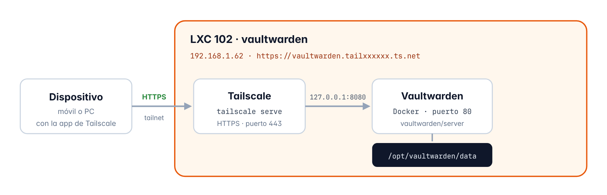

# Capítulo 7 · Vaultwarden

*Mi propio gestor de contraseñas, que funciona con las apps de Bitwarden y está publicado con HTTPS usando Tailscale*

[← Pi-hole](06-pihole.md) · [Índice](../README.md#documentación) · [Tailscale (acceso remoto) →](08-tailscale.md)

## 7.1 Qué es y cómo funciona

**Vaultwarden** es un servidor que funciona igual que Bitwarden pero mucho más ligero que el oficial, y las contraseñas se cifran en el propio dispositivo con la **contraseña maestra** antes de enviarse, o sea que el servidor solo guarda datos cifrados

En mi homelab Vaultwarden funciona con Docker dentro del contenedor 102 y solo escucha dentro de ese contenedor (`127.0.0.1:8080`), y luego **Tailscale**, que está en el mismo contenedor, lo publica con un certificado HTTPS válido en una dirección a la que solo se puede entrar desde los dispositivos que están en la tailnet



*Figura 4 · Cómo llega un dispositivo hasta Vaultwarden*

> [!NOTE]
> **Lo que necesita cada dispositivo**
>
> La dirección de Vaultwarden solo existe dentro de la tailnet, así que para usarlo cada dispositivo tiene que tener la app de Tailscale instalada y activada, también cuando está en casa, y desde internet no se puede llegar a Vaultwarden

## 7.2 Ficha del contenedor

| Elemento | Detalle |
| --- | --- |
| ID | `102` |
| Nombre de host | `vaultwarden` |
| Tipo | Contenedor LXC sin privilegios, con anidamiento y `keyctl` |
| Sistema | Debian 13 (plantilla `debian-13-standard_13.1-2_amd64.tar.zst`) |
| Recursos | 1 núcleo · 1024 MiB de RAM · 512 MiB de swap · disco de 8 GiB en `local-lvm` |
| Red | `eth0` en `vmbr0` · `192.168.1.62/24` · puerta de enlace `192.168.1.1` |
| Dispositivos | `/dev/net/tun`, que lo necesita Tailscale |
| Arranque | Se enciende solo al arrancar el servidor, el segundo (orden 2) |
| Zona horaria | La misma que el servidor (`Europe/Madrid`) |
| Software | Docker CE con Compose · Tailscale · Vaultwarden |
| Datos | `/opt/vaultwarden/data` |
| Acceso | `https://vaultwarden.tailxxxxxx.ts.net` |

## 7.3 Creación del contenedor

Lo creo con el botón **Crear CT** y estos son los valores que puse en cada pestaña

| Pestaña | Campo | Valor |
| --- | --- | --- |
| **General** | CT ID | `102` |
|  | Nombre de host | `vaultwarden` |
|  | Contenedor sin privilegios | Sí |
|  | Anidamiento | Sí |
|  | Contraseña de root | *Puesta, pero no la apunto aquí* |
| **Plantilla** | Almacenamiento / Plantilla | `local / debian-13-standard_13.1-2` |
| **Discos** | Almacenamiento / Tamaño | `local-lvm` · 8 GiB |
| **CPU** | Núcleos | 1 |
| **Memoria** | Memoria / Swap | 1024 MiB / 512 MiB |
| **Red** | Nombre / Puente | `eth0 / vmbr0` |
|  | IPv4 | Estático · `192.168.1.62/24` |
|  | Puerta de enlace (IPv4) | `192.168.1.1` |
|  | IPv6 | Estático, vacío |
| **DNS** | Dominio y servidores | Vacíos (coge lo que tiene el servidor) |
| **Confirmar** | Iniciar después de creado | **No** |

> [!NOTE]
> **Por qué 1 GB de RAM y por qué no lo enciendo todavía**
>
> En este contenedor van a la vez Docker, Tailscale y Vaultwarden, por eso le doy más memoria que a Pi-hole, y no lo enciendo al crearlo porque antes le tengo que dar los permisos del apartado siguiente

## 7.4 Ajustes desde Proxmox

Esto lo hago desde la **Shell de Proxmox** con el contenedor todavía apagado

```bash
pct set 102 --features keyctl=1,nesting=1
pct set 102 --dev0 /dev/net/tun
pct set 102 --timezone host
pct set 102 --onboot 1 --startup order=2
pct start 102
```

| Elemento | Detalle |
| --- | --- |
| `--features keyctl=1,nesting=1` | Son los permisos que necesita Docker para poder funcionar dentro de un contenedor sin privilegios |
| `--dev0 /dev/net/tun` | Le da acceso a la tarjeta de red virtual que usa Tailscale |
| `--timezone host` | La misma zona horaria que el servidor |
| `--onboot 1 --startup order=2` | Que se encienda solo y el segundo, después de Pi-hole |

En el router hice la reserva DHCP de `192.168.1.62` para la MAC del contenedor, que se ve en **102 → Red**

## 7.5 Preparación del sistema

Desde **102 → Consola** y con el usuario `root` hago esto

```bash
apt update && apt full-upgrade -y
apt install -y ca-certificates curl nano
date
ls -l /dev/net/tun
```

`date` enseña la hora de España y `ls -l /dev/net/tun` me confirma que el dispositivo de Tailscale está ahí

## 7.6 Instalación de Docker

Docker lo instalo desde su **repositorio oficial** para Debian y no desde el de Debian, para tener siempre la última versión, y todo esto en la consola del contenedor

```bash
# Clave con la que se firman los paquetes de Docker
install -m 0755 -d /etc/apt/keyrings
curl -fsSL https://download.docker.com/linux/debian/gpg -o /etc/apt/keyrings/docker.asc
chmod a+r /etc/apt/keyrings/docker.asc

# Repositorio de Docker
tee /etc/apt/sources.list.d/docker.sources <<EOF
Types: deb
URIs: https://download.docker.com/linux/debian
Suites: $(. /etc/os-release && echo "$VERSION_CODENAME")
Components: stable
Architectures: $(dpkg --print-architecture)
Signed-By: /etc/apt/keyrings/docker.asc
EOF

# Instalación y prueba
apt update
apt install -y docker-ce docker-ce-cli containerd.io docker-buildx-plugin docker-compose-plugin
docker run --rm hello-world
```

> [!TIP]
> **Resultado**
>
> La prueba `docker run --rm hello-world` sacó «Hello from Docker!» a la primera, o sea que Docker funciona bien dentro del contenedor

## 7.7 Tailscale y HTTPS

### Preparación en el panel de Tailscale

Primero en `login.tailscale.com` hago dos cosas

1. En **Machines** borro la máquina de la instalación de antes (`docker`)
2. En **DNS** activo **MagicDNS** y **HTTPS Certificates**, que hacen falta para que Tailscale le pueda dar a cada máquina un nombre y un certificado HTTPS válido

### Instalación en el contenedor

Luego instalo Tailscale en la consola del contenedor

```bash
curl -fsSL https://tailscale.com/install.sh -o install-tailscale.sh
sh install-tailscale.sh
tailscale up
```

`tailscale up` te da un enlace que abro en el navegador del PC para iniciar sesión con mi cuenta de Tailscale, y desde ese momento el contenedor sale en el panel como la máquina `vaultwarden`

> [!WARNING]
> **Le quito la caducidad a la clave**
>
> Tailscale por defecto te obliga a volver a iniciar sesión en cada máquina cada 180 días, y en un servidor eso haría que Vaultwarden dejara de funcionar sin avisar, así que en el panel, en la máquina `vaultwarden`, elegí **… → Disable key expiry**

### Publicación con HTTPS

Y para publicarlo con HTTPS pongo esto en la consola del contenedor

```bash
tailscale serve --bg 8080
tailscale serve status
```

```text
https://vaultwarden.tailxxxxxx.ts.net (tailnet only)
|-- / proxy http://127.0.0.1:8080
```

| Elemento | Detalle |
| --- | --- |
| `--bg` | Deja la publicación puesta en segundo plano, y sigue ahí aunque se reinicie el contenedor |
| `tailnet only` | A la dirección solo se puede entrar desde dispositivos de la tailnet y no desde internet |
| `proxy http://127.0.0.1:8080` | Tailscale recibe las conexiones HTTPS y se las pasa a Vaultwarden dentro del contenedor |

## 7.8 Instalación de Vaultwarden

Vaultwarden lo he montado con **Docker Compose**, así que lo primero es crear una carpeta para él en `/opt` y dentro el archivo `compose.yaml`, todo esto desde la consola del contenedor

```bash
mkdir -p /opt/vaultwarden
cd /opt/vaultwarden
nano compose.yaml
```

Y dentro del archivo he puesto esto

```yaml
services:
  vaultwarden:
    image: vaultwarden/server:latest
    container_name: vaultwarden
    restart: unless-stopped
    environment:
      DOMAIN: "https://vaultwarden.tailxxxxxx.ts.net"
      SIGNUPS_ALLOWED: "true"
    volumes:
      - ./data:/data
    ports:
      - "127.0.0.1:8080:80"
```

| Elemento | Detalle |
| --- | --- |
| `image` | La imagen oficial de Vaultwarden en la última versión |
| `restart: unless-stopped` | Se vuelve a encender solo si se cae o si reinicio el contenedor, menos si lo paro yo a mano |
| `DOMAIN` | La dirección con la que entro a Vaultwarden, que la necesita para que los enlaces salgan bien |
| `SIGNUPS_ALLOWED` | Deja crear cuentas, y lo pongo en `"true"` solo para poder crearme la mía (apartado 7.9) |
| `./data:/data` | Los datos se guardan fuera de Docker, en `/opt/vaultwarden/data`, así que aunque borre el contenedor de Docker no pierdo nada |
| `127.0.0.1:8080:80` | Vaultwarden solo escucha dentro del contenedor, es decir que la única forma de entrar es por Tailscale y siempre con HTTPS |

Después ya lo arranco y miro que esté funcionando

```bash
docker compose up -d
docker compose ps
```

```text
vaultwarden   vaultwarden/server:latest   "/start.sh"   vaultwarden   1 hours ago   Up 1 hours (healthy)   127.0.0.1:8080->80/tcp
```

Si pone **healthy** es que Vaultwarden ha pasado su propia comprobación y está todo bien, y el panel de administración no lo he activado porque no he puesto ningún `ADMIN_TOKEN`, así que por ahí no hay nada que tocar

## 7.9 Cuenta e importación

1. **Crear la cuenta**, con Tailscale activado en el PC abro `https://vaultwarden.tailxxxxxx.ts.net` y me creo la cuenta
2. **Importar las contraseñas**, en **Herramientas → Importar datos** con el formato **Bitwarden (json)** elijo el archivo que exporté antes de reinstalar (apartado 2.1) y pongo la contraseña del archivo
3. **Comprobar**, todo se importó bien
4. **Cerrar los registros**, para que nadie más se pueda crear una cuenta cambio `SIGNUPS_ALLOWED` a `"false"` en `compose.yaml` y vuelvo a aplicar el cambio

```yaml
      SIGNUPS_ALLOWED: "false"

docker compose up -d
```

> [!WARNING]
> **La contraseña maestra**
>
> La contraseña maestra no se puede recuperar, y si se te olvida no hay forma de abrir la caja fuerte, ni siquiera entrando al servidor

## 7.10 Aplicaciones de Bitwarden

Vaultwarden lo tengo puesto en el **móvil** y en el **PC**, y en cada app hice esto

1. Cierro la sesión del servidor de antes
2. En la pantalla de iniciar sesión elijo **Autoalojado** (self-hosted)
3. Pongo la dirección `https://vaultwarden.tailxxxxxx.ts.net` e inicio sesión

## 7.11 Copia de seguridad provisional

Hasta que tenga un disco externo para las copias automáticas, hago una copia a mano del contenedor y la guardo en el PC

### Copia en Proxmox

Se hace en **102 → Copia de seguridad → Hacer copia ahora**

| Elemento | Detalle |
| --- | --- |
| Almacenamiento | `local` |
| Modo | Instantánea (no hace falta apagar el contenedor) |
| Compresión | ZSTD |

### Aviso de SSH después de reinstalar

Cuando intenté bajar la copia con `scp`, SSH no me dejó conectar y me salió esto

```text
@    WARNING: REMOTE HOST IDENTIFICATION HAS CHANGED!     @
The fingerprint for the ED25519 key sent by the remote host is
SHA256:XXXXXXXXXXXXXXXXXXXXXXXXXXXXXXXXXXXXXXXXXXX.
Host key verification failed.
```

Cada servidor tiene unas **claves de host** que lo identifican y mi PC se acordaba de las del Proxmox de antes, entonces al reinstalar se crearon claves nuevas y SSH avisa porque no sabe si es eso o si alguien se está haciendo pasar por el servidor, así que antes de aceptar las nuevas comprobé que la huella era la de mi servidor de verdad desde la Shell de Proxmox

```bash
ssh-keygen -lf /etc/ssh/ssh_host_ed25519_key.pub
```

```text
256 SHA256:XXXXXXXXXXXXXXXXXXXXXXXXXXXXXXXXXXXXXXXXXXX root@pve (ED25519)
```

La huella es la misma que la del aviso, o sea que es mi servidor, así que borré la clave vieja del PC y bajé la copia a la carpeta de Descargas con PowerShell, aceptando la huella nueva al conectar

```powershell
ssh-keygen -R 192.168.1.60
scp root@192.168.1.60:/var/lib/vz/dump/vzdump-lxc-102-*.tar.zst "$HOME\Downloads\"
```

| Elemento | Detalle |
| --- | --- |
| Archivo | `vzdump-lxc-102-2026_09_23-21_35_14.tar.zst` |
| Tamaño | ≈ 608 MB |
| Dónde está | En la carpeta de Descargas del PC |

## 7.12 Resumen

| Qué he comprobado | Resultado |
| --- | --- |
| El contenedor 102 creado con los valores que tenía pensados | Correcto |
| Docker funcionando (`hello-world` a la primera) | Correcto |
| Vaultwarden funcionando y en estado `healthy` | Correcto |
| Publicado con HTTPS solo dentro de la tailnet | Correcto |
| Quitada la caducidad de la clave de Tailscale | Configurado |
| Contraseñas importadas y registros cerrados | Correcto |
| Las apps puestas en el móvil y en el PC | Correcto |
| Copia de seguridad bajada al PC | Correcto |
| Reserva DHCP de la `.62` en el router | Configurado |

> **Siguiente paso** · Capítulo 8 · Tailscale · LXC 103 · 192.168.1.66  
> Entrar a toda la red de casa desde fuera y con las mismas IPs

---

[← Pi-hole](06-pihole.md) · [Índice](../README.md#documentación) · [Tailscale (acceso remoto) →](08-tailscale.md)
