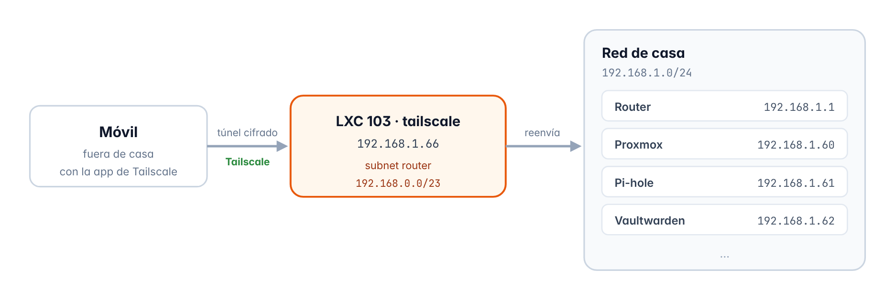

# Capítulo 8 · Tailscale (acceso remoto)

*Entrar a toda la red de casa desde fuera y con las mismas IPs, gracias a un contenedor que hace de subnet router*

[← Vaultwarden](07-vaultwarden.md) · [Índice](../README.md#documentación) · [Uptime Kuma →](09-uptime-kuma.md)

## 8.1 Qué es y cómo funciona

Un **subnet router** es una máquina de la tailnet que te deja entrar a una red entera y no solo a ella misma, entonces el contenedor 103 le dice a la tailnet que pasando por él se puede llegar a la red de casa, y así con la app de Tailscale activada el móvil puede abrir `http://192.168.1.61/admin` o `https://192.168.1.60:8006` desde fuera como si estuviera en casa, y los marcadores me sirven igual dentro que fuera



*Figura 5 · Entrar a la red de casa desde fuera pasando por el subnet router*

### Por qué anuncio 192.168.0.0/23 y no 192.168.1.0/24

La red de casa es `192.168.1.0/24`, pero si anunciara esa misma red, un dispositivo que está en casa con Tailscale activado tendría dos caminos iguales para llegar a `192.168.1.x` y el sistema podría mandar el tráfico por Tailscale en vez de directo, y en el peor de los casos el dispositivo se queda sin DNS y sin internet

Por eso anuncio `192.168.0.0/23`, que es una red un poco más grande que tiene dentro la de casa, ya que los sistemas operativos siempre eligen la ruta **más concreta** (la que tiene el número más alto después de la barra)

| Dónde está el dispositivo | Caminos hacia 192.168.1.x | Cuál gana | Qué pasa |
| --- | --- | --- | --- |
| **En casa** | Red local `/24` y Tailscale `/23` | La `/24`, que es más concreta | El tráfico va directo, sin pasar por Tailscale |
| **Fuera de casa** | Solo Tailscale `/23` | La `/23` | El tráfico pasa por el contenedor 103 |

> [!NOTE]
> **Lo que no funciona**
>
> Si el dispositivo está en el WiFi de otra casa que también use `192.168.1.x` (pasa mucho con los routers de Movistar), gana la red de esa casa y no se llega a las IPs del homelab, pero con datos móviles no pasa, y Vaultwarden funciona siempre porque usa su propia dirección de Tailscale

## 8.2 Ficha del contenedor

| Elemento | Detalle |
| --- | --- |
| ID | `103` |
| Nombre de host | `tailscale` |
| Tipo | Contenedor LXC sin privilegios y con anidamiento |
| Sistema | Debian 13 (plantilla `debian-13-standard_13.1-2_amd64.tar.zst`) |
| Recursos | 1 núcleo · 512 MiB de RAM · 512 MiB de swap · disco de 8 GiB en `local-lvm` |
| Red | `eth0` en `vmbr0` · `192.168.1.66/24` · puerta de enlace `192.168.1.1` |
| Dispositivos | `/dev/net/tun`, que lo necesita Tailscale |
| Arranque | Se enciende solo al arrancar el servidor, el tercero (orden 3) |
| Zona horaria | La misma que el servidor (`Europe/Madrid`) |
| Ruta anunciada | `192.168.0.0/23` |
| IP en la tailnet | `100.64.0.1` |

## 8.3 Creación del contenedor

Lo creo con el botón **Crear CT** y estos son los valores que puse en cada pestaña

| Pestaña | Campo | Valor |
| --- | --- | --- |
| **General** | Nodo | `pve` |
|  | CT ID | `103` |
|  | Nombre de host | `tailscale` |
|  | Contenedor sin privilegios | Sí |
|  | Anidamiento | Sí |
|  | Contraseña de root | *Puesta, pero no la apunto aquí* |
|  | Clave SSH pública | Vacío |
| **Plantilla** | Almacenamiento / Plantilla | `local / debian-13-standard_13.1-2` |
| **Discos** | Almacenamiento / Tamaño | `local-lvm` · 8 GiB |
| **CPU** | Núcleos | 1 |
| **Memoria** | Memoria / Swap | 512 MiB / 512 MiB |
| **Red** | Nombre / Puente | `eth0 / vmbr0` |
|  | Etiqueta VLAN / Cortafuegos | Vacío / como viene (marcado) |
|  | IPv4 | Estático · `192.168.1.66/24` |
|  | Puerta de enlace (IPv4) | `192.168.1.1` |
|  | IPv6 | Estático, vacío |
| **DNS** | Dominio y servidores | Vacíos (coge lo que tiene el servidor) |
| **Confirmar** | Iniciar después de creado | **No** |

## 8.4 Ajustes desde Proxmox

Esto lo hago desde la **Shell de Proxmox** con el contenedor todavía apagado

```bash
pct set 103 --dev0 /dev/net/tun
pct set 103 --timezone host
pct set 103 --onboot 1 --startup order=3
pct start 103
```

| Elemento | Detalle |
| --- | --- |
| `--dev0 /dev/net/tun` | Le da acceso a la tarjeta de red virtual que usa Tailscale |
| `--timezone host` | La misma zona horaria que el servidor |
| `--onboot 1 --startup order=3` | Que se encienda solo y el tercero, después de Pi-hole y Vaultwarden |

En el router hice la reserva DHCP de `192.168.1.66` para la MAC del contenedor (`BC:24:11:XX:XX:XX`)

## 8.5 Preparación del sistema

Desde **103 → Consola** y con el usuario `root` hago esto

```bash
apt update && apt full-upgrade -y
apt install -y curl
date
ls -l /dev/net/tun
```

## 8.6 Reenvío de tráfico

Para hacer de puente entre la tailnet y la red de casa el contenedor tiene que poder **pasar paquetes** de una red a otra, igual que un router, pero Linux por defecto no lo hace, así que lo activo en la consola del contenedor

```bash
echo 'net.ipv4.ip_forward = 1' | tee -a /etc/sysctl.d/99-tailscale.conf
echo 'net.ipv6.conf.all.forwarding = 1' | tee -a /etc/sysctl.d/99-tailscale.conf
sysctl -p /etc/sysctl.d/99-tailscale.conf
```

| Elemento | Detalle |
| --- | --- |
| `net.ipv4.ip_forward = 1` | Activa el reenvío de paquetes en IPv4 |
| `net.ipv6.conf.all.forwarding = 1` | Lo mismo pero en IPv6, que Tailscale lo recomienda aunque la red de casa sea IPv4 |
| `/etc/sysctl.d/99-tailscale.conf` | Al guardarlo en este archivo el cambio se queda aunque reinicie |
| `sysctl -p` | Aplica el archivo en ese momento sin tener que reiniciar |

## 8.7 Instalación de Tailscale

Luego instalo Tailscale también desde la consola del contenedor

```bash
curl -fsSL https://tailscale.com/install.sh -o install-tailscale.sh
sh install-tailscale.sh
tailscale up --advertise-routes=192.168.0.0/23
```

`--advertise-routes` sirve para decir qué red le ofrezco a la tailnet, y `tailscale up` te da un enlace que abro en el navegador del PC para iniciar sesión con mi cuenta de Tailscale

## 8.8 Configuración en el panel

En `login.tailscale.com` → **Machines**, en el menú **…** de la máquina `tailscale`, hago esto

1. **Edit route settings**, marco la ruta `192.168.0.0/23` y guardo, porque Tailscale no activa ninguna ruta anunciada hasta que la apruebas aquí
2. **Disable key expiry**, igual que con Vaultwarden, para que el contenedor no pierda la sesión a los 180 días

> [!NOTE]
> **El PC de casa**
>
> En la app de Tailscale del PC dejo sin marcar la opción **Use Tailscale subnets**, ya que el PC siempre está en casa y no le hace falta usar el subnet router

> [!NOTE]
> **DNS de la tailnet**
>
> Más adelante, en la parte de **DNS** de este mismo panel, puse Pi-hole (`192.168.1.61`) como DNS de toda la tailnet para que también bloquee anuncios fuera de casa, y las consultas de los dispositivos que están fuera llegan a Pi-hole pasando por este contenedor, todo esto lo explico en el apartado 6.15

## 8.9 Verificación

Para ver que está todo bien miro el estado de Tailscale en la consola del contenedor

```bash
tailscale status
```

```text
100.64.0.1      tailscale        usuario@  linux    -
100.64.0.2      pc-windows       usuario@  windows  -
100.64.0.3      iphone-13        usuario@  iOS      idle, tx 8069492 rx 460148
100.64.0.4      portatil         usuario@  linux    offline, last seen 1d ago
100.64.0.5      vaultwarden      usuario@  linux    -
```

El contenedor sale en la tailnet con la IP `100.64.0.1`, junto con el resto de mis dispositivos

### Pruebas de acceso

| Prueba | Qué abrí | Resultado |
| --- | --- | --- |
| Móvil con **datos móviles** y Tailscale activado | Pi-hole en `http://192.168.1.61/admin` | Correcto |
| Móvil con **datos móviles** y Tailscale activado | Proxmox en `https://192.168.1.60:8006` | Correcto |
| Móvil **en casa** con Tailscale activado | Internet y los servicios de casa | Correcto |

Todo cargó a la primera y sin cambiar nada en la app de Tailscale del móvil

## 8.10 Resumen

| Qué he comprobado | Resultado |
| --- | --- |
| El contenedor 103 creado con los valores que tenía pensados y la IP `192.168.1.66` | Correcto |
| Reenvío de tráfico activado | Correcto |
| Tailscale instalado y anunciando `192.168.0.0/23` | Correcto |
| Ruta aprobada y quitada la caducidad de la clave | Configurado |
| Se puede entrar a las IPs del homelab desde fuera de casa | Correcto |
| Los dispositivos que están en casa con Tailscale activado funcionan normal | Correcto |
| Reserva DHCP de la `.66` en el router | Configurado |

> **Siguiente paso** · Capítulo 9 · Uptime Kuma · LXC 104 · 192.168.1.64  
> Vigilar que todos los servicios del homelab estén funcionando

---

[← Vaultwarden](07-vaultwarden.md) · [Índice](../README.md#documentación) · [Uptime Kuma →](09-uptime-kuma.md)
