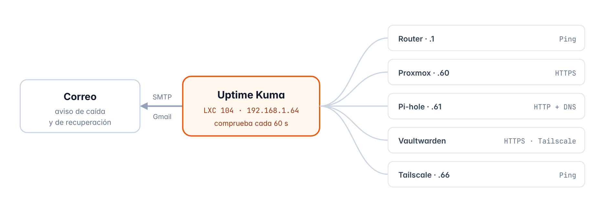

# Capítulo 9 · Uptime Kuma

*Vigilar todos los servicios del homelab y que me llegue un correo cuando alguno deja de funcionar*

[← Tailscale (acceso remoto)](08-tailscale.md) · [Índice](../README.md#documentación) · [Jellyfin →](10-jellyfin.md)

## 9.1 Qué es y cómo funciona

**Uptime Kuma** mira cada 60 segundos que todos los servicios contesten, y dependiendo del servicio lo hace con un ping, abriendo su página web o haciendo una consulta DNS, entonces si alguno deja de contestar me manda un correo y cuando vuelve me manda otro, y todo se puede ver en su panel web en `http://192.168.1.64:3001`

Lo he instalado directamente con **Node.js**, sin Docker, y el contenedor también lleva **Tailscale** porque a Vaultwarden solo se puede llegar por su dirección de Tailscale, y así lo puede comprobar de verdad, incluido su certificado HTTPS



*Figura 6 · Qué comprueba Uptime Kuma y cómo me avisa*

> [!NOTE]
> **Lo que no puede vigilar**
>
> Uptime Kuma está en el mismo servidor que los servicios que vigila, así que me avisa si se cae un servicio pero no puede avisarme si se apaga el Chromebox entero o si se va internet en casa

## 9.2 Ficha del contenedor

| Elemento | Detalle |
| --- | --- |
| ID | `104` |
| Nombre de host | `uptime-kuma` |
| Tipo | Contenedor LXC sin privilegios y con anidamiento |
| Sistema | Debian 13 (plantilla `debian-13-standard_13.1-2_amd64.tar.zst`) |
| Recursos | 1 núcleo · 1024 MiB de RAM · 512 MiB de swap · disco de 8 GiB en `local-lvm` |
| Red | `eth0` en `vmbr0` · `192.168.1.64/24` · puerta de enlace `192.168.1.1` |
| Dispositivos | `/dev/net/tun`, que lo necesita Tailscale |
| Arranque | Se enciende solo al arrancar el servidor, el cuarto (orden 4) |
| Zona horaria | La misma que el servidor (`Europe/Madrid`) |
| Software | Node.js 20.19 (el paquete de Debian 13) · Uptime Kuma 2 · Tailscale |
| Instalación | En `/opt/uptime-kuma`, como servicio `uptime-kuma` de systemd |
| Base de datos | SQLite |
| Panel web | `http://192.168.1.64:3001` |
| Avisos | Por correo con Gmail (SMTP, puerto 587) |

## 9.3 Comprobación previa de la IP

Antes de crear el contenedor miro que ningún otro dispositivo de la red esté usando la `192.168.1.64`, y para eso uso `arping` desde la Shell de Proxmox, que pregunta directamente en la red quién tiene esa IP, y a diferencia del ping aquí ningún dispositivo puede dejar de contestar

```bash
arping -c 3 -I vmbr0 192.168.1.64
```

No contestó **nadie**, o sea que la IP está libre

## 9.4 Creación del contenedor

Lo creo con el botón **Crear CT** y estos son los valores que puse en cada pestaña

| Pestaña | Campo | Valor |
| --- | --- | --- |
| **General** | Nodo | `pve` |
|  | CT ID | `104` |
|  | Nombre de host | `uptime-kuma` |
|  | Contenedor sin privilegios | Sí |
|  | Anidamiento | Sí |
|  | Contraseña de root | *Puesta, pero no la apunto aquí* |
|  | Clave SSH pública | Vacío |
| **Plantilla** | Almacenamiento / Plantilla | `local / debian-13-standard_13.1-2` |
| **Discos** | Almacenamiento / Tamaño | `local-lvm` · 8 GiB |
| **CPU** | Núcleos | 1 |
| **Memoria** | Memoria / Swap | 1024 MiB / 512 MiB |
| **Red** | Nombre / Puente | `eth0 / vmbr0` |
|  | Etiqueta VLAN / Cortafuegos | Vacío / como viene (marcado) |
|  | IPv4 | Estático · `192.168.1.64/24` |
|  | Puerta de enlace (IPv4) | `192.168.1.1` |
|  | IPv6 | Estático, vacío |
| **DNS** | Dominio y servidores | Vacíos (coge lo que tiene el servidor) |
| **Confirmar** | Iniciar después de creado | **No** |

> [!NOTE]
> **Por qué 1 GB de RAM**
>
> Uptime Kuma gasta poco cuando ya está funcionando, pero al instalarlo con `npm` necesita bastante memoria durante unos minutos

## 9.5 Ajustes desde Proxmox

Esto lo hago desde la Shell de Proxmox con el contenedor todavía apagado

```bash
pct set 104 --dev0 /dev/net/tun
pct set 104 --timezone host
pct set 104 --onboot 1 --startup order=4
pct start 104
```

Lo de `/dev/net/tun` es para Tailscale, y el contenedor arranca el cuarto para que cuando se encienda los servicios que vigila ya estén funcionando, y en el router hice la reserva DHCP de `192.168.1.64` para la MAC del contenedor

## 9.6 Preparación del sistema

En la consola del contenedor actualizo el sistema e instalo lo que hace falta

```bash
apt update && apt full-upgrade -y
apt install -y curl git nodejs npm
date
node --version
ping -c 10 1.1.1.1
```

| Elemento | Detalle |
| --- | --- |
| `git` | Para bajar el código de Uptime Kuma |
| `nodejs / npm` | Es con lo que funciona Uptime Kuma y su gestor de paquetes, y Uptime Kuma 2 necesita Node.js 20.4 o más, y Debian 13 trae la 20.19 |
| `ping -c 10 1.1.1.1` | Para ver que internet va estable (0 % de pérdida) antes de instalar nada |

## 9.7 Instalación de Uptime Kuma

Luego bajo Uptime Kuma y lo preparo, también en la consola del contenedor

```bash
git clone https://github.com/louislam/uptime-kuma.git /opt/uptime-kuma
cd /opt/uptime-kuma
npm run setup
```

`git clone` baja el proyecto oficial en `/opt/uptime-kuma` y `npm run setup` elige la última versión estable, instala lo que necesita y baja la web ya preparada, y en este servidor tarda unos cuantos minutos, y los avisos `npm WARN` que salen mientras tanto son normales

## 9.8 Servicio de arranque automático

Para que Uptime Kuma se encienda solo con el contenedor y se reinicie si falla, le creo un servicio de **systemd** con este archivo

```ini
[Unit]
Description=Uptime Kuma
After=network-online.target
Wants=network-online.target

[Service]
Type=simple
WorkingDirectory=/opt/uptime-kuma
ExecStart=/usr/bin/node server/server.js
Restart=on-failure
RestartSec=5

[Install]
WantedBy=multi-user.target
```

| Elemento | Detalle |
| --- | --- |
| `After / Wants` | Espera a que la red esté lista antes de arrancar |
| `WorkingDirectory` | La carpeta desde donde se ejecuta Uptime Kuma |
| `ExecStart` | El comando que arranca Uptime Kuma con Node.js |
| `Restart=on-failure` | Si se cierra por un error, systemd lo vuelve a arrancar a los 5 segundos |
| `WantedBy=multi-user.target` | Hace que se encienda solo cada vez que arranca el contenedor |

Y después activo el servicio

```bash
systemctl daemon-reload
systemctl enable --now uptime-kuma
systemctl status uptime-kuma
ss -tlnp | grep 3001
```

El servicio se quedó en **active (running)** y escuchando en el puerto `3001`

## 9.9 Primer acceso

1. Desde el PC abro `http://192.168.1.64:3001`
2. Como base de datos elijo **SQLite**, que es un solo archivo, no necesita otro servidor y para un homelab va de sobra
3. Creo el usuario administrador del panel *(los datos no los apunto aquí)*
4. El idioma se puede cambiar en **Ajustes → Apariencia → Idioma**

## 9.10 Tailscale en el contenedor

Para que Uptime Kuma pueda comprobar Vaultwarden por su dirección de verdad, meto el contenedor en la tailnet desde su consola

```bash
curl -fsSL https://tailscale.com/install.sh -o install-tailscale.sh
sh install-tailscale.sh
tailscale up
```

Después de iniciar sesión, en el panel de Tailscale le quité la caducidad a la clave de la máquina `uptime-kuma` (**… → Disable key expiry**), igual que en los contenedores 102 y 103

## 9.11 Monitores

Los creé con **Añadir nuevo monitor**, todos para que comprueben cada 60 segundos

| Nombre | Tipo | Dirección o datos | Notas |
| --- | --- | --- | --- |
| Router | Ping | `192.168.1.1` |  |
| Proxmox | HTTP(s) | `https://192.168.1.60:8006` | Con «Ignorar errores TLS/SSL», porque el certificado lo hace Proxmox |
| Pi-hole (web) | HTTP(s) | `http://192.168.1.61/admin/` |  |
| Pi-hole (DNS) | DNS | Nombre `google.com` · Servidor `192.168.1.61` · Puerto `53` | Mira que Pi-hole resuelva nombres |
| Vaultwarden | HTTP(s) | `https://vaultwarden.tailxxxxxx.ts.net/alive` | También avisa si va a caducar el certificado |
| Tailscale (subnet router) | Ping | `192.168.1.66` |  |

> [!NOTE]
> **Tipo de monitor**
>
> El campo cambia según el tipo que elijas, en los HTTP(s) pone **URL** y en Ping y DNS pone **Hostname**, y en el monitor DNS el *Hostname* es el nombre que quieres resolver (`google.com`) y la IP de Pi-hole va en *Servidor de resolución*

## 9.12 Avisos por correo

### Contraseña de aplicación de Google

Gmail no deja que un programa mande correos con la contraseña normal de la cuenta, así que hace falta una **contraseña de aplicación**, que solo sirve para esto y se puede borrar cuando quieras sin que le pase nada a la cuenta

1. La **verificación en dos pasos** de la cuenta de Google tiene que estar activada
2. En `myaccount.google.com` busco **Contraseñas de aplicaciones**
3. Creo una que se llame `Uptime Kuma` y copio la contraseña de 16 letras, que solo te la enseña una vez

### Configuración en Uptime Kuma

Esto va en **Ajustes → Notificaciones → Configurar notificación**

| Elemento | Detalle |
| --- | --- |
| Tipo de notificación | Correo electrónico (SMTP) |
| Nombre descriptivo | `Correo` |
| Nombre de host | `smtp.gmail.com` |
| Puerto | `587` |
| Seguridad | Ninguna / STARTTLS (25, 587) |
| Ignorar error TLS | No |
| Usuario | *Mi dirección de Gmail (no la apunto aquí)* |
| Contraseña | *La contraseña de aplicación (no la apunto aquí)* |
| Remitente / destinatario | *Mis correos (no los apunto aquí)* |
| Activado por defecto | Sí, así los monitores nuevos ya lo tienen activado |
| Aplicar en todos los monitores existentes | Sí |

Le di al botón **Probar**, me llegó el correo de prueba y guardé la notificación, y el aviso se puede cambiar o ampliar cuando quiera desde la misma pantalla, por ejemplo añadiendo Telegram

## 9.13 Verificación

Para comprobar que Uptime Kuma de verdad detecta las caídas y avisa, paré Vaultwarden a propósito desde la consola del contenedor 102 y luego lo volví a arrancar

```bash
cd /opt/vaultwarden
docker compose stop
  … esperar uno o dos minutos …
docker compose start
```

| Momento | En el panel | Correo |
| --- | --- | --- |
| Vaultwarden parado | El monitor se pone en Caído | Me llega el aviso de caída |
| Vaultwarden arrancado otra vez | El monitor vuelve a Activo | Me llega el aviso de que ha vuelto |

## 9.14 Resumen

| Qué he comprobado | Resultado |
| --- | --- |
| La IP `192.168.1.64` estaba libre antes de crear el contenedor | Correcto |
| El contenedor 104 creado con los valores que tenía pensados | Correcto |
| Node.js 20.4 o más e internet sin pérdidas | Correcto |
| Uptime Kuma instalado como servicio y escuchando en el puerto 3001 | Correcto |
| Tailscale instalado y quitada la caducidad de la clave | Configurado |
| Los seis monitores creados y todos activos | Correcto |
| Me llegaron los correos de prueba, de caída y de recuperación | Correcto |
| Reserva DHCP de la `.64` en el router | Configurado |

> **Siguiente paso** · Capítulo 10 · Jellyfin · LXC 105 · 192.168.1.65  
> Mi servidor de películas, que convierte el vídeo con la gráfica

---

[← Tailscale (acceso remoto)](08-tailscale.md) · [Índice](../README.md#documentación) · [Jellyfin →](10-jellyfin.md)
