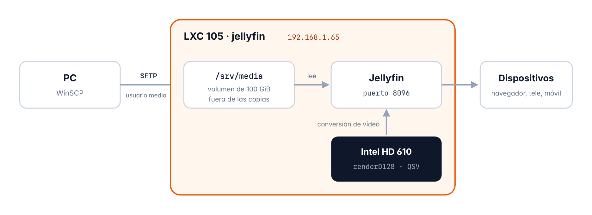

# Capítulo 10 · Jellyfin

*Mi propio servidor para ver películas y series en cualquier dispositivo, que convierte el vídeo con la gráfica Intel*

[← Uptime Kuma](09-uptime-kuma.md) · [Índice](../README.md#documentación) · [Glosario →](anexo-a-glosario.md)

## 10.1 Qué es y cómo funciona

**Jellyfin** ordena las películas y las series, les baja la carátula y la sinopsis y las manda a cualquier dispositivo, ya sea el navegador, la tele o el móvil, y si algún dispositivo no puede reproducir el formato del archivo Jellyfin lo **convierte en el momento** (a esto se le llama transcodificar), y esa conversión la hace la gráfica Intel del servidor con **QuickSync** y no el procesador

Las películas se guardan en un volumen aparte de 100 GiB dentro del contenedor y las subo desde el PC por SFTP



*Figura 7 · Cómo subo, guardo y veo las películas*

> [!NOTE]
> **Lo que da de sí la gráfica HD 610**
>
> Lo mejor es la **reproducción directa**, que es cuando el dispositivo reproduce el archivo tal cual y el servidor casi no trabaja, y cuando hay que convertir se encarga la gráfica, pero en la prueba (apartado 10.11) una sola conversión a 720p le ocupó entre el 70 % y el 90 % de su parte de vídeo, o sea que **una conversión a la vez va bien pero dos irían justas**, y además no puede pasar de HDR a SDR (*tone mapping*) porque lo que hace falta de Intel (OpenCL) para esta gráfica no existe en Debian 13, aunque las películas HDR se ven bien en los dispositivos que las reproducen directamente

## 10.2 Ficha del contenedor

| Elemento | Detalle |
| --- | --- |
| ID | `105` |
| Nombre de host | `jellyfin` |
| Tipo | Contenedor LXC sin privilegios y con anidamiento |
| Sistema | Debian 13 (plantilla `debian-13-standard_13.1-2_amd64.tar.zst`) |
| Recursos | 2 núcleos · 2048 MiB de RAM · 512 MiB de swap · disco de 16 GiB en `local-lvm` |
| Volumen de películas | `mp0` de 100 GiB en `local-lvm`, montado en `/srv/media` y sin copia de seguridad |
| Gráfica | `/dev/dri/renderD128`, con el grupo `video` (GID 44) |
| Red | `eth0` en `vmbr0` · `192.168.1.65/24` · puerta de enlace `192.168.1.1` |
| Arranque | Se enciende solo al arrancar el servidor, el quinto (orden 5) |
| Zona horaria | La misma que el servidor (`Europe/Madrid`) |
| Software | Jellyfin desde su repositorio oficial, con `jellyfin-ffmpeg` |
| Aceleración | Intel QuickSync (QSV) |
| Subida de archivos | SFTP con el usuario `media` |
| Panel web | `http://192.168.1.65:8096` |

## 10.3 Comprobación previa de la IP

Igual que con Uptime Kuma, antes de nada miro desde la Shell de Proxmox que la IP no la use nadie

```bash
arping -c 3 -I vmbr0 192.168.1.65
```

No contestó **nadie**, así que la IP está libre

## 10.4 Creación del contenedor

Lo creo con el botón **Crear CT** y estos son los valores que puse en cada pestaña

| Pestaña | Campo | Valor |
| --- | --- | --- |
| **General** | Nodo | `pve` |
|  | CT ID | `105` |
|  | Nombre de host | `jellyfin` |
|  | Contenedor sin privilegios | Sí |
|  | Anidamiento | Sí |
|  | Contraseña de root | *Puesta, pero no la apunto aquí* |
|  | Clave SSH pública | Vacío |
| **Plantilla** | Almacenamiento / Plantilla | `local / debian-13-standard_13.1-2` |
| **Discos** | Almacenamiento / Tamaño | `local-lvm` · 16 GiB |
| **CPU** | Núcleos | 2 |
| **Memoria** | Memoria / Swap | 2048 MiB / 512 MiB |
| **Red** | Nombre / Puente | `eth0 / vmbr0` |
|  | Etiqueta VLAN / Cortafuegos | Vacío / como viene (marcado) |
|  | IPv4 | Estático · `192.168.1.65/24` |
|  | Puerta de enlace (IPv4) | `192.168.1.1` |
|  | IPv6 | Estático, vacío |
| **DNS** | Dominio y servidores | Vacíos (coge lo que tiene el servidor) |
| **Confirmar** | Iniciar después de creado | **No** |

> [!NOTE]
> **Por qué tiene más recursos que los demás**
>
> Jellyfin es el servicio que más pide, ya que usa 2 núcleos cuando convierte vídeo, 2 GB de RAM y 16 GiB de disco para su base de datos, las carátulas y los archivos temporales de las conversiones, y las películas no van en este disco sino en el volumen del apartado siguiente

## 10.5 Ajustes desde Proxmox

Esto lo hago desde la Shell de Proxmox con el contenedor todavía apagado

```bash
pct set 105 --mp0 local-lvm:100,mp=/srv/media,backup=0
pct set 105 --dev0 /dev/dri/renderD128,gid=44
pct set 105 --timezone host
pct set 105 --onboot 1 --startup order=5
pct start 105
```

| Elemento | Detalle |
| --- | --- |
| `--mp0 local-lvm:100,mp=/srv/media,backup=0` | Crea un volumen nuevo de 100 GiB, lo monta en `/srv/media` y lo deja fuera de las copias de seguridad, porque las películas ocuparían muchísimo y se pueden volver a conseguir |
| `--dev0 /dev/dri/renderD128,gid=44` | Le pasa la gráfica al contenedor con el grupo `video` (que en Debian es el GID 44), y luego meto en ese grupo al usuario de Jellyfin |
| `--timezone host` | La misma zona horaria que el servidor |
| `--onboot 1 --startup order=5` | Que se encienda solo y el último de todos |

En el router hice la reserva DHCP de `192.168.1.65` para la MAC del contenedor

## 10.6 Preparación del sistema

En la consola del contenedor actualizo el sistema y miro que esté todo bien

```bash
apt update && apt full-upgrade -y
apt install -y curl
date
ping -c 10 1.1.1.1
ls -l /dev/dri
df -h /srv/media
```

Internet va sin pérdidas, el dispositivo `renderD128` está ahí con el grupo `video` y el volumen de películas está montado en `/srv/media` con unos 98 GiB para usar, y lo que falta hasta 100 lo ocupa el propio sistema de archivos

## 10.7 Instalación de Jellyfin

Uso el instalador oficial, que añade el repositorio de Jellyfin e instala el servidor, la web y `jellyfin-ffmpeg`, y este último ya trae el driver de vídeo de Intel (iHD), así que no hace falta instalar drivers aparte

```bash
curl -fsSL https://repo.jellyfin.org/install-debuntu.sh -o install-jellyfin.sh
bash install-jellyfin.sh
```

Después le doy permiso a Jellyfin para usar la gráfica y compruebo que la reconoce

```bash
usermod -aG video jellyfin
systemctl restart jellyfin
systemctl status jellyfin
/usr/lib/jellyfin-ffmpeg/vainfo --display drm --device /dev/dri/renderD128
```

| Elemento | Detalle |
| --- | --- |
| `usermod -aG video jellyfin` | Mete al usuario del servicio en el grupo `video`, que es el que puede usar la gráfica |
| `vainfo` | Enseña el driver que está cargado y los formatos que puede procesar la gráfica, y me salió el **driver iHD de Intel** con su lista de formatos |

## 10.8 Carpetas y subida de películas

Luego preparo el SFTP, el usuario y las carpetas en la consola del contenedor

```bash
apt install -y openssh-server
adduser media
mkdir -p /srv/media/peliculas /srv/media/series
chown -R media:media /srv/media/peliculas /srv/media/series
```

Las películas las sube un usuario normal (`media`) y no `root`, ya que Jellyfin solo tiene que poder leerlas

### Subida desde el PC con WinSCP

| Elemento | Detalle |
| --- | --- |
| Protocolo | SFTP |
| Servidor / puerto | `192.168.1.65` · `22` |
| Usuario | `media` |
| Destino | `/srv/media/peliculas` o `/srv/media/series` |

### Nombres de archivo

Para que Jellyfin reconozca cada título y le baje la carátula y la sinopsis hay que seguir esta estructura

| Tipo | Ruta de ejemplo |
| --- | --- |
| Película | `peliculas/Titulo (Año)/Titulo (Año).mkv` |
| Serie | `series/Nombre Serie/Season 01/Nombre Serie S01E01.mkv` |

## 10.9 Asistente inicial

En `http://192.168.1.65:8096` elijo el idioma **Español**, creo el usuario administrador *(los datos no los apunto aquí)* y hago dos bibliotecas

| Biblioteca | Carpeta | Metadatos |
| --- | --- | --- |
| Películas | `/srv/media/peliculas` | Idioma Español · País España |
| Programas | `/srv/media/series` | Idioma Español · País España |

Las demás pantallas del asistente las dejé como venían

## 10.10 Aceleración por hardware

Esto está en **Panel de control → Reproducción → Transcodificación**

| Opción | Valor |
| --- | --- |
| Aceleración por hardware | **Intel QuickSync (QSV)** |
| Dispositivo QSV | `/dev/dri/renderD128` |
| Decodificación por hardware activada para | H264, HEVC, MPEG2, VC1, VP8, VP9, HEVC 10bit, VP9 10bit |
| Decodificación desactivada para | AV1 y HEVC RExt, porque la HD 610 no los soporta |
| Codificadores de bajo consumo (H.264 y HEVC) | Desactivados |
| Permitir codificación en HEVC | Desactivado, para que funcione en todos los dispositivos |
| Mapeo de tonos (tone mapping) | Desactivado, porque con esta gráfica en Debian 13 no se puede |

## 10.11 Verificación

Puse una película en el navegador obligando a que la convierta (**Ajustes → Calidad → 720p – 2 Mbps** en el reproductor), y mientras tanto miré cuánto se usaba la gráfica desde la Shell de Proxmox

```bash
apt install -y intel-gpu-tools
intel_gpu_top
```

| Prueba | Resultado | Estado |
| --- | --- | --- |
| Subir una película por SFTP | La reconoció con su carátula y su sinopsis a la primera | Correcto |
| Conversión a 720p – 2 Mbps | La fila **Video** de `intel_gpu_top` estaba entre el **70 % y el 90 %**, o sea que la conversión la hace la gráfica | Correcto |
| Monitor en Uptime Kuma | HTTP(s) a `http://192.168.1.65:8096/health`, en verde | Correcto |

## 10.12 Resumen

| Qué he comprobado | Resultado |
| --- | --- |
| La IP `192.168.1.65` estaba libre y el contenedor 105 creado con los valores que tenía pensados | Correcto |
| El volumen de películas de 100 GiB montado y fuera de las copias | Correcto |
| La gráfica llega al contenedor y `vainfo` la reconoce (driver iHD) | Correcto |
| Jellyfin instalado desde el repositorio oficial y funcionando | Correcto |
| Subida de películas por SFTP con el usuario `media` | Correcto |
| Conversión de vídeo con la gráfica usando QuickSync | Correcto |
| Monitor de Jellyfin en Uptime Kuma | Configurado |
| Reserva DHCP de la `.65` en el router | Configurado |

> **Siguiente paso** · Copias de seguridad  
> Copias automáticas de todos los contenedores en un disco externo cuando lo tenga, y después pasar las películas a ese disco

---

[← Uptime Kuma](09-uptime-kuma.md) · [Índice](../README.md#documentación) · [Glosario →](anexo-a-glosario.md)
